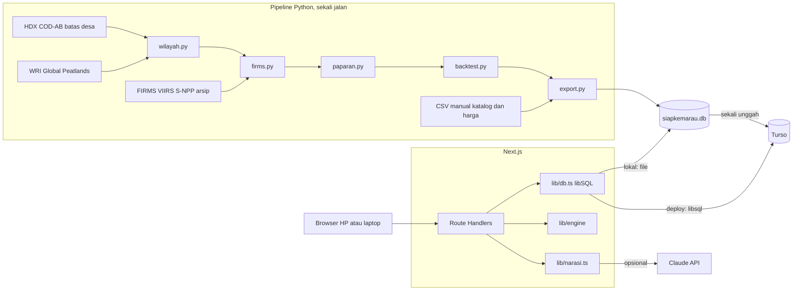

# 02 — Technical Requirements Document: SiapKemarau

> Turunan dari [01_PRD.md](01_PRD.md). Skema basis data lengkap ada di [05_BACKEND_SCHEMA.md](05_BACKEND_SCHEMA.md).

## 1. Prinsip

1. Perhitungan berat selesai di pipeline offline. Aplikasi hanya membaca hasil dan menghitung mesin ringan.
2. Satu basis data SQLite-compatible, dengan kode yang sama untuk localhost dan deployment.
3. Tidak menambah dependensi jika platform sudah menyediakan fungsinya.
4. Setiap fitur P0 tetap hidup tanpa internet dan tanpa kunci API.
5. **Semua kode ditulis selama Hacking Week di repositori baru.** Tidak ada kode dari caliber-final.

## 2. Arsitektur



## 3. Stack

| Lapisan | Pilihan | Alasan |
|---|---|---|
| Web | Next.js App Router, TypeScript, versi stabil saat init | Satu kode untuk halaman dan API, deploy sederhana |
| Gaya | Tailwind CSS | Cepat, tanpa pustaka komponen |
| DB client | `@libsql/client` | URL `file:` di lokal dan `libsql://` di deploy, tanpa ganti kode |
| DB deploy | Turso | Filesystem Vercel tidak persisten untuk SQLite |
| Validasi | `zod` | Validasi input di batas API |
| Peta | `maplibre-gl` | Hanya untuk poligon desa terpilih dan Time Machine |
| Grafik | SVG tangan | Strip tahun dan gauge sederhana |
| AI | `@anthropic-ai/sdk` | Narasi usulan |
| Password | `node:crypto` `scrypt` | Tanpa dependensi |
| Cetak | CSS `@media print` dan `window.print()` | Fitur browser, tanpa pustaka PDF |
| Tes | Vitest, pytest | Mesin dan pipeline |
| Pipeline | Python 3.11+, `geopandas`, `pyogrio`, `pandas`, `scipy` | Geospasial dan distribusi Beta |

Versi Turso, batas kuota gratis, dan sintaks SDK terbaru **wajib dicek di dokumentasi resmi saat pemasangan**. Dokumen ini tidak mengikat angka kuota.

## 4. Sumber data

| Data | Akses | Dipakai untuk | Lisensi | Status per 9 Nov |
|---|---|---|---|---|
| FIRMS VIIRS S-NPP | Arsip web (antrean surel), cadangan API `VIIRS_SNPP_SP` dengan MAP_KEY | Deteksi 20 Jan 2012 sampai 2 Nov 2026 | Cek saat unduh dan cantumkan | Arsip belum diuji, API butuh kunci |
| HDX COD-AB Indonesia | Unduh SHP atau GDB, sumber BPS | Batas desa | CC BY-IGO | Metadata aktif |
| WRI Global Peatlands | Unduh | Porsi gambut | CC BY 4.0 | Laman aktif, belum diunduh |
| ONI NOAA CPC | Teks | Konteks halaman Data | Terbuka | Aktif |
| Standar regu | Dokumen DLHK Banten | Target awal | Dokumen publik | Terbaca |
| Harga | Dikumpulkan manual | Prioritas | Sesuai sumber | **Belum ada** |

**Jangan pakai GADM**, karena lisensinya melarang redistribusi. **Jangan pakai** `sipongi.menlhk.go.id`, karena domain itu sudah mati.

S-NPP dipilih sebagai sensor tunggal agar jumlah deteksi konsisten sepanjang 2012-2026. NOAA-20 dan NOAA-21 tidak digabung.

**Cadangan jika arsip terlambat.** Tarik API area FIRMS dengan `DAY_RANGE=5` untuk kotak Kalimantan, sekitar 1.080 permintaan untuk 2012-2026. Perilaku riwayat API belum diuji. Uji satu permintaan lama pada hari pertama.

## 5. Spesifikasi pipeline

Semua fungsi dapat diuji tanpa file besar. Modul ada di `pipeline/` dan nama file tanpa awalan angka agar bisa diimpor.

| Modul | Fungsi | Keluaran |
|---|---|---|
| `wilayah.py` | `load_desa(path, prov_codes) -> GeoDataFrame`, `peat_fraction(desa, peat) -> Series`, `simplify_geom(geom, max_bytes) -> str` | Desa Kalbar dan Kalteng |
| `firms.py` | `load_detections(paths) -> DataFrame`, `assign_to_desa(det, desa, buffer_km) -> DataFrame`, `desa_year(assigned, kode_list, years, min_det_days) -> DataFrame`, `kecamatan_bulan(assigned, desa) -> DataFrame` | Tabel desa-tahun dan bulan puncak |
| `paparan.py` | `exposure(desa_year, ext_years, last_year, quiet_window) -> DataFrame`, `beta_posterior(k, n, prior_mean, s) -> tuple`, `shrink_desa(k, n, p_kec, s) -> float`, `tier(k_ext, n_ext) -> str` | Paparan beku dan live |
| `backtest.py` | `top_k_capture(score, y, k_pct) -> float`, `auc(score, y) -> float`, `blind_spot_groups(frozen, y) -> DataFrame`, `gate(groups, min_lift, min_exposed) -> bool` | Metrik dan gerbang |
| `export.py` | `build_db(path, tables)` | `data/siapkemarau.db` |
| `run_all.py` | Menjalankan semuanya | Log dan angka kontrol |

**Parameter (tombol kalibrasi, disimpan di `meta`)**

| Kunci | Nilai | Arti |
|---|---|---|
| `buffer_km` | 2 | Penyangga area desa, karena api bisa datang dari tetangga dan titik VIIRS punya galat lokasi |
| `min_det_days` | 2 | Menekan deteksi tunggal yang mungkin keliru |
| `quiet_window` | 3 | Syarat "tampak aman" |
| `s_kab` | 10 | Kekuatan prior kabupaten untuk kecamatan |
| `s_desa` | 2 | Kekuatan penarikan desa ke kecamatan |
| `freeze_date` | 2025-12-31 | Batas pengetahuan Time Machine |

Sensitivitas `buffer_km` (0, 2, 5) dan `min_det_days` (1, 2, 3) dicatat di log, disimpan sebagai JSON pada `meta` kunci `sensitivitas`, dan ditampilkan di halaman Data.

**Rumus**

```text
Kecamatan:
  m    = rata-rata terpapar kabupaten pada tahun ekstrem
  a    = m * s_kab + k_kec
  b    = (1 - m) * s_kab + (n_kec - k_kec)
  p    = a / (a + b)
  p05, p95 = kuantil Beta(a, b)

Desa (hanya untuk mengurutkan):
  skor = (k_ext + s_desa * p_kec) / (n_ext + s_desa)
```

Dua mode dihitung. `frozen` memakai data sampai 31 Des 2025 dan tahun ekstrem 2015, 2019, 2023. `live` memakai data sampai 2 Nov 2026 dan menambahkan 2026.

**Time Machine.** Tidak boleh ada data 2026 dalam mode `frozen`.

| Strategi | Skor |
|---|---|
| `paparan` | `skor` beku |
| `persistensi` | Jumlah hari berdeteksi 2025 |
| `gambut` | `peat_frac` |
| `acak` | Nilai harapan `k_pct` |

Target: terpapar 2026. Metrik: capture top 10%, 20%, 30%, dan AUC. Kecamatan menjadi angka utama, desa menjadi angka pendamping.

**Gerbang:** `rate(tampak_aman) >= 1,5 * rate(tanpa_riwayat_ekstrem)` dan minimal 30 desa tampak aman terpapar pada 2026. Gagal tidak menghentikan proyek, tetapi menghapus klaim "tampak aman". Lihat Brief bagian 8.

**Batas ukuran.** `data/siapkemarau.db` wajib di bawah 50 MB. Poligon disederhanakan sampai maksimal 4.000 byte per desa.

## 6. Mesin aplikasi

Kode: `src/lib/engine/`. Fungsi murni tanpa akses DB.

```ts
export type Tier = "rendah" | "sedang" | "tinggi";
export type Status = "siap" | "sebagian" | "rawan";
export type Aksi = "perbaiki" | "beli";

export interface CatalogItem {
  kode: string; nama: string; satuan: string;
  bobot: number; kritis: boolean; bisaDibeli: boolean;
}
export interface InventoryRow { itemKode: string; total: number; berfungsi: number; }
export interface TargetRow { itemKode: string; target: number; }
export interface PriceRow { itemKode: string; aksi: Aksi; hargaRp: number; }

export interface ReadinessItem {
  itemKode: string; target: number; berfungsi: number; rusak: number;
  coverage: number; kritis: boolean; belumDiisi: boolean;
}
export interface ReadinessResult {
  skor: number; status: Status; rantaiTerlemah: string | null;
  lengkap: boolean; items: ReadinessItem[];
}
export function computeReadiness(
  catalog: CatalogItem[], targets: TargetRow[], inventory: InventoryRow[]
): ReadinessResult;

export interface PriorityRow {
  itemKode: string; aksi: Aksi; qty: number; biayaRp: number;
  alasan: string; kestabilan?: "stabil" | "peka";
}
export interface PriorityResult {
  paguRp: number; terpakaiRp: number; skorSesudah: number;
  terpilih: PriorityRow[]; tidakTerdanai: PriorityRow[]; tanpaHarga: string[];
}
export function rankPriorities(input: {
  catalog: CatalogItem[]; readiness: ReadinessResult;
  prices: PriceRow[]; paguRp: number;
}): PriorityResult;
export function addStability(
  input: Parameters<typeof rankPriorities>[0], result: PriorityResult
): PriorityResult;
```

**Kesiapan**

- `coverage = min(berfungsi / target, 1)`. Item dengan target 0 tidak dihitung.
- `skor = 100 * Σ(bobot * coverage) / Σ(bobot)`, dibulatkan 1 desimal.
- `rawan` jika ada item kritis dengan coverage di bawah 0,25, atau skor di bawah 40.
- `siap` jika skor minimal 80 dan semua item kritis minimal 0,75.
- Selain itu `sebagian`.
- `rantaiTerlemah` adalah item kritis dengan coverage terkecil, urut kode saat seri.
- Item belum diisi dianggap 0 dan `lengkap = false`.

**Prioritas (greedy per unit)**

1. Kandidat per unit: `perbaiki` untuk unit rusak, `beli` untuk sisa kesenjangan. Item `bisaDibeli = false` dilewati. Item tanpa harga masuk `tanpaHarga`.
2. Nilai kandidat: `gain = bobot * (Δcoverage) * f`, dengan `f = 1,5` jika item kritis dan coverage saat ini di bawah 0,25, selain itu `f = 1`.
3. Ambil kandidat dengan `gain / biaya` tertinggi yang masih muat di sisa pagu. Hitung ulang coverage. Ulangi sampai tidak ada kandidat yang muat. Seri diurutkan oleh `perbaiki` lebih dulu, lalu kode.
4. Gabungkan kandidat terpilih per `(item, aksi)` menjadi satu baris dengan alasan dari template.

Alasan contoh: `Selang keluar 2 dari 6 rol. Mata rantai terlemah. Menaikkan cakupan ke 67%.`

**Kestabilan.** Jalankan ulang pada kisi harga `×{0,7; 1; 1,3}` dan bobot `×{0,7; 1; 1,3}`. Baris `stabil` jika terpilih pada minimal 80% skenario.

`greedy` tidak menjamin solusi knapsack optimal. Pilihan ini sengaja diambil karena mudah dijelaskan di musyawarah, dan ditandai komentar `ponytail:` di kode.

## 7. Narasi AI

Keputusan desain kunci: **AI tidak pernah menulis angka atau nama.** AI hanya menulis kalimat dengan placeholder.

```text
facts (JSON dari sistem) -> Claude -> teks dengan {{placeholder}}
  -> validateNarrative -> gagal: template
  -> berhasil: renderNarrative -> teks final + sumber_teks = "ai"
```

| Hal | Ketentuan |
|---|---|
| Model | `ANTHROPIC_MODEL`, default `claude-opus-5-5` |
| Input ke AI | Hanya nama placeholder, kanal, dan label kualitatif. Catatan bebas pengguna **tidak dikirim**, untuk mencegah prompt injection |
| Tolak jika | Ada digit di luar placeholder, placeholder tak dikenal, pola `Desa/Kecamatan/Kabupaten/Provinsi` + nama, atau placeholder wajib hilang |
| Placeholder wajib | `{{desa}}`, `{{skor}}`, `{{total_usulan}}` |
| Batas | Timeout 15 detik, 10 permintaan per akun per jam |
| Gagal | Selalu jatuh ke `renderTemplate(facts, kanal)` tanpa pesan error ke pengguna |

Fungsi di `src/lib/narasi.ts`:

```ts
export function validateNarrative(text: string, allowed: string[]):
  { ok: boolean; violations: string[] };
export function renderNarrative(text: string, facts: Record<string, string>): string;
export function renderTemplate(facts: Record<string, string>, kanal: Kanal): string;
export async function generateNarrative(
  facts: Record<string, string>, kanal: Kanal
): Promise<{ teks: string; sumber: "ai" | "template"; model: string | null }>;
```

## 8. API

Semua respons JSON. Galat berbentuk `{ "error": { "kode": string, "pesan": string } }`.

| Metode | Path | Akses | Isi |
|---|---|---|---|
| GET | `/api/desa?q=` | Publik | Maks. 20 hasil |
| GET | `/api/desa/[kode]` | Publik | Desa, strip tahun, paparan live, kecamatan |
| GET | `/api/backtest` | Publik | Metrik dan grup |
| GET | `/api/data` | Publik | Sumber, masalah data, meta |
| POST | `/api/auth/masuk` | Publik, dibatasi | Membuat sesi |
| POST | `/api/auth/keluar` | Akun | Menghapus sesi |
| GET | `/api/auth/saya` | Akun | Akun aktif |
| GET, PUT | `/api/desa/[kode]/inventaris` | `mpa`, `desa` | Baca, simpan |
| GET, PUT | `/api/desa/[kode]/target` | GET keduanya, PUT `desa` | Target efektif, ubah dengan alasan |
| GET, PUT | `/api/desa/[kode]/harga` | GET keduanya, PUT `desa` | Harga efektif, ubah |
| GET | `/api/desa/[kode]/kesiapan` | `mpa`, `desa` | `ReadinessResult` |
| GET | `/api/desa/[kode]/prioritas` | `desa` | `PriorityResult` memakai pagu tersimpan |
| PUT | `/api/desa/[kode]/rencana` | `desa` | Pagu |
| PUT | `/api/desa/[kode]/keputusan` | `desa` | Keputusan satu baris |
| GET, POST | `/api/desa/[kode]/usulan` | `desa` | Daftar, terbitkan |
| GET | `/api/desa/[kode]/usulan/[id]` | `desa` | Satu usulan |

## 9. Keamanan

| Ancaman | Kontrol |
|---|---|
| Password bocor | `scrypt` dengan salt acak per akun, `timingSafeEqual` |
| Sesi dicuri | Token 32 byte acak, disimpan sebagai SHA-256, cookie `httpOnly`, `SameSite=Lax`, `Secure` di produksi, kedaluwarsa 7 hari |
| CSRF | `SameSite=Lax` dan cek header `Origin` pada semua metode tulis |
| Akses lintas desa | `requireDesaAccess(kode, peran[])` di setiap handler berparameter desa |
| Injection SQL | Semua kueri berparameter |
| XSS | Tanpa `dangerouslySetInnerHTML`. Narasi dirender sebagai teks |
| Tebak password | Maks. 10 percobaan per 15 menit per kombinasi username dan IP |
| Prompt injection | Catatan bebas tidak dikirim ke AI |
| Kebocoran kredensial | `.env` di `.gitignore`, `.env.example` tanpa nilai |
| Penyalahgunaan akun demo | `is_demo` menampilkan banner dan hanya punya satu desa |

## 10. Lingkungan

```text
DATABASE_URL=file:data/siapkemarau.db   # deploy: libsql://...
DATABASE_AUTH_TOKEN=                    # kosong di lokal
ANTHROPIC_API_KEY=                      # kosong: pakai template
ANTHROPIC_MODEL=claude-opus-5-5
DEMO_PASSWORD=                          # dipakai seed akun demo
```

## 11. Struktur repositori

```text
siapkemarau/
  README.md  .env.example  .gitignore
  db/schema.sql
  data/siapkemarau.db
  data/manual/{katalog_item,target_standar,harga_item,sumber_data,dq_issue}.csv
  pipeline/{wilayah,firms,paparan,backtest,export,run_all}.py
  pipeline/tests/
  pipeline/requirements.txt
  scripts/{seed-accounts,push-remote}.ts
  src/app/...              # halaman dan route handler
  src/components/...
  src/lib/*.ts             # akses data, auth, narasi, logika per fitur
  src/lib/engine/{types,readiness,priority,stability}.ts
```

Data mentah tidak dimasukkan ke repositori. README menjelaskan cara mengunduhnya.

## 12. Deployment dan final

| Lingkungan | Perintah | DB |
|---|---|---|
| Lokal dan final | `npm ci && npm run build && npm start` | `file:data/siapkemarau.db` |
| Deploy lomba | Vercel | Turso |

Sebelum final: jalankan alur demo di localhost tanpa kunci API dan tanpa internet, kecuali latar peta. Sesudah freeze, deployment tidak boleh diubah kecuali memulihkan layanan tanpa mengubah kode, fitur, atau data.

## 13. Pengujian

| Lapisan | Alat | Cakupan wajib |
|---|---|---|
| Pipeline | pytest | Filter confidence, penyangga, ambang hari, definisi tenang, kebocoran 2026 pada mode beku, rumus Beta |
| Mesin | Vitest | Batas status, seri, pagu nol, tanpa harga, gabungan baris |
| Narasi | Vitest | Validator menolak digit, placeholder asing, nama wilayah |
| API | Vitest pada `lib` | Otorisasi lintas desa dan validasi berfungsi tidak melebihi total |
| Akhir ke akhir | Skrip manual | Alur demo pada lebar 360 px dan laptop |
