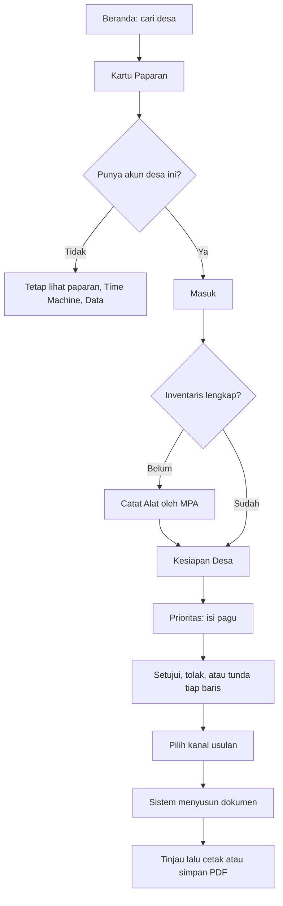

# 03 — App Flow Document: SiapKemarau

> Turunan dari [01_PRD.md](01_PRD.md). Endpoint ada di [02_TRD.md](02_TRD.md) bagian 8.

## 1. Peta halaman

| Path | Nama | Akses | FR |
|---|---|---|---|
| `/` | Beranda dan pencarian desa | Publik | FR-01 |
| `/desa/[kode]` | Kartu Paparan | Publik | FR-02, FR-03 |
| `/time-machine` | Time Machine | Publik | FR-04 |
| `/data` | Data dan Asumsi | Publik | FR-05 |
| `/masuk` | Masuk | Publik | FR-06 |
| `/desa/[kode]/kesiapan` | **Kesiapan Desa (hero)** | `mpa`, `desa` | FR-10, FR-17 |
| `/desa/[kode]/inventaris` | Catat Alat | `mpa`, `desa` | FR-07, FR-08 |
| `/desa/[kode]/prioritas` | Prioritas | `desa` | FR-09, FR-11, FR-12, FR-13, FR-14 |
| `/desa/[kode]/usulan` | Daftar dan Terbitkan Usulan | `desa` | FR-15 |
| `/desa/[kode]/usulan/[id]` | Dokumen Usulan dan Cetak | `desa` | FR-15, FR-16 |

Navigasi bawah pada HP, sesudah masuk: **Kesiapan, Alat, Prioritas, Usulan**. Akun `mpa` hanya melihat Kesiapan dan Alat.

## 2. Alur utama

## 3. Detail tiap layar

### 3.1 Beranda `/`

| Unsur | Isi |
|---|---|
| Judul | Tagline dan satu kalimat produk |
| Kotak cari | Mencari setelah 2 karakter, jeda 250 ms |
| Angka | Jumlah desa tampak aman di wilayah cakupan, dari data |
| Tautan | Time Machine, Data dan Asumsi |

Input: teks. Proses: `GET /api/desa?q=`. Output: daftar `Desa, Kecamatan, Kabupaten`.

| Keadaan | Tampilan |
|---|---|
| Tidak ada hasil | "Desa tidak ditemukan. Cakupan saat ini Kalimantan Barat dan Kalimantan Tengah." |
| Di bawah 2 karakter | Petunjuk pencarian |
| Gagal jaringan | Pesan dan tombol coba lagi |

### 3.2 Kartu Paparan `/desa/[kode]`

Urutan dari atas:

1. Nama desa dan wilayah.
2. **Kalimat utama**, dibentuk dari data. Contoh bentuk: "Terdeteksi satelit pada {k} dari {n} tahun kering ekstrem. {t} tahun terakhir tenang."
3. Label tingkat paparan, dan label "Tampak aman" jika memenuhi.
4. Strip 2012-2026: satu sel per tahun. Tahun ekstrem diberi penanda. Sel terpapar berisi warna dan tanda.
5. Peluang kecamatan dengan rentang 5-95%.
6. Porsi gambut.
7. Peta kecil poligon desa.
8. Tombol **"Periksa kesiapan desa ini"** menuju `/desa/[kode]/kesiapan` atau `/masuk`.
9. Catatan kecil dan tautan ke Data: "Deteksi satelit bukan hitungan kebakaran. Awan dan asap bisa menutupi api."

| Keadaan | Tampilan |
|---|---|
| Tidak pernah terdeteksi | "Belum ada deteksi satelit memenuhi ambang sejak 2012. Ini bukan jaminan aman." Label "Tampak aman" **tidak** dipakai |
| Kode tidak ada | Halaman 404 dengan tautan ke pencarian |

### 3.3 Time Machine `/time-machine`

1. Pernyataan: "Bayangkan hari ini 31 Desember 2025. Hanya data sampai tanggal itu yang dipakai."
2. Peta titik desa teratas menurut peringkat beku.
3. Tombol **"Buka 2026"** menampilkan deteksi nyata 2026 pada desa yang sama.
4. Tabel capture top 10, 20, 30% untuk strategi paparan, persistensi, gambut, acak. Baris pemenang diberi tanda.
5. Tiga kartu grup: tampak aman, aktif, tanpa riwayat ekstrem. Masing-masing dengan laju terpapar 2026.
6. Bagian "Apa yang tidak bisa dibuktikan halaman ini": tidak mengukur hektare terselamatkan, target adalah deteksi satelit, dan 2026 di luar rezim normal.

Halaman menampilkan hasil apa adanya. Jika paparan kalah dari persistensi, kalimat kesimpulan mengatakannya.

### 3.4 Data dan Asumsi `/data`

Tiga bagian: **Sumber** (nama, lisensi, periode, tanggal akses), **Batasan data** (dari `dq_issue`), **Asumsi** (parameter `meta`, bobot, target, sensitivitas). Akhiri dengan penggunaan AI: model, bagian yang memakai, dan batasnya.

### 3.5 Masuk `/masuk`

Input: username, password. Berhasil: menuju `/desa/[kode]/kesiapan`. Gagal: "Username atau password salah." tanpa menyebut mana yang salah. Terlalu banyak percobaan: "Coba lagi dalam 15 menit."

### 3.6 Catat Alat `/desa/[kode]/inventaris`

Formulir satu kolom per item: stepper jumlah total, stepper jumlah berfungsi, catatan opsional. Tombol simpan menempel di bawah.

| Validasi | Pesan |
|---|---|
| Berfungsi lebih besar dari total | "Jumlah berfungsi tidak boleh melebihi jumlah total." |
| Negatif atau bukan angka | "Isi dengan angka 0 atau lebih." |

| Keadaan | Tampilan |
|---|---|
| Sinyal hilang saat simpan (P1) | "Tersimpan di HP ini. Kirim saat ada sinyal." dengan tombol kirim |
| Tersimpan | Pesan sukses, nama pengisi, waktu. Tombol ke Kesiapan |

### 3.7 Kesiapan Desa `/desa/[kode]/kesiapan` (hero)

1. Banner akun demo jika `is_demo`: "Akun demonstrasi. Isian alat adalah data uji, bukan survei lapangan."
2. **Gauge skor** dan status dalam kata.
3. **Mata rantai terlemah**, satu kalimat.
4. Ringkasan paparan satu baris, dengan tautan ke Kartu Paparan.
5. Hitung mundur ke bulan puncak deteksi kecamatan (P1).
6. Daftar item terurut dari kesenjangan terbesar: batang cakupan, `berfungsi / target`, tanda rusak.
7. Tombol **"Susun prioritas"**.

| Keadaan | Tampilan |
|---|---|
| Belum ada inventaris | Ajakan "Catat alat dulu" dan tautan |
| Sebagian terisi | Skor ditampilkan dengan label "Belum lengkap" |

Akun `mpa` tidak melihat tombol Susun Prioritas.

### 3.8 Prioritas `/desa/[kode]/prioritas`

1. Input pagu dalam Rupiah, dengan penggeser dan kotak angka.
2. Ringkas: terpakai, sisa, skor sekarang menuju skor sesudah.
3. **Daftar terpilih**: urutan, aksi, item, jumlah, biaya, alasan, label kestabilan (P1), tombol Setuju/Tolak/Tunda.
4. Daftar tidak terdanai.
5. Item tanpa harga, dengan tombol isi harga.
6. Kesenjangan non-biaya, misalnya anggota aktif.
7. Sisi target dan harga: tampil sumbernya. Mengubah target wajib alasan.
8. Tombol **"Terbitkan usulan"**, aktif jika minimal satu baris disetujui.

| Keadaan | Tampilan |
|---|---|
| Pagu 0 | "Masukkan pagu untuk melihat urutan." |
| Pagu di bawah harga termurah | "Pagu belum cukup untuk satu item. Item termurah: {item}, {harga}." |
| Semua harga kosong | "Belum ada harga. Isi harga dari penawaran setempat." |

Mengubah pagu sesudah ada keputusan: keputusan tetap tersimpan per `(item, aksi)` dan hanya berlaku pada baris yang masih terpilih.

### 3.9 Usulan `/desa/[kode]/usulan`

Daftar usulan yang pernah terbit, pilihan kanal, tombol terbitkan. Kanal:

| Kanal | Sapaan dokumen | Penekanan |
|---|---|---|
| `apbdes_perubahan` | Musyawarah Desa | Pos belanja dan kesiapan |
| `bpbd` | Kepala BPBD Kabupaten | Paparan dan kesenjangan |
| `daops` | Kepala Daops Manggala Agni | Alat dan anggota |
| `csr` | Perusahaan sekitar | Daftar barang dan dampak kesiapan |

### 3.10 Dokumen Usulan `/desa/[kode]/usulan/[id]`

Isi: identitas desa, ringkasan paparan, kondisi kesiapan, tabel item disetujui dengan biaya dan alasan, narasi, kolom tanda tangan kosong, lampiran sumber data. Badge sumber: "Disusun AI dari data terhitung. Angka diisi sistem. Wajib ditinjau manusia." atau "Disusun dari template". Tombol **Cetak** memanggil `window.print()`.

Dokumen tidak boleh mencantumkan klaim hektare terselamatkan.

## 4. Matriks akses

| Aksi | Publik | `mpa` | `desa` |
|---|---|---|---|
| Lihat paparan, Time Machine, Data | Ya | Ya | Ya |
| Catat alat desa sendiri | | Ya | Ya |
| Lihat kesiapan desa sendiri | | Ya | Ya |
| Ubah target, harga, pagu | | | Ya |
| Putuskan baris | | | Ya |
| Terbitkan usulan | | | Ya |
| Akses desa lain | | Tidak (403) | Tidak (403) |

Belum masuk pada halaman berakun: alihkan ke `/masuk`. Sesi berakhir: alihkan ke `/masuk`, draf inventaris tetap di perangkat.

## 5. Skrip video demo (3-5 menit, satu rekaman utuh)

Aturan: dari commit final, tanpa slide, mockup, animasi, atau hasil rekayasa. Urutan wajib Guidebook hal. 19 tercermin di bawah.

| Waktu | Layar | Yang dibuktikan |
|---|---|---|
| 0:00 | Beranda | Identitas aplikasi |
| 0:20 | Cari desa, Kartu Paparan | Data satelit nyata, label "tampak aman" |
| 0:50 | Masuk `demo-mpa`, Catat Alat | Input nyata di aplikasi, banner data uji terlihat |
| 1:30 | Kesiapan Desa | Proses: skor dan mata rantai terlemah |
| 2:00 | Keluar, masuk `demo-sekdes`, Prioritas | Ubah pagu, daftar berubah, alasan per baris |
| 2:50 | Putuskan baris, Terbitkan usulan | Output dan integrasi AI langsung |
| 3:30 | Dokumen, badge AI, Cetak | Output akhir |
| 3:50 | Time Machine, buka 2026 | Pembuktian klaim, termasuk batasnya |
| 4:30 | Data dan Asumsi | Transparansi |

## 6. Alur presentasi final (7 menit, localhost)

| Menit | Isi |
|---|---|
| 0-1 | Masalah: kasus jangkar dan satu fakta tahun tenang |
| 1-2 | Celah: yang sudah ada, yang belum |
| 2-5 | Live demo: paparan, alat, kesiapan, prioritas, usulan |
| 5-6 | Time Machine: bukti dan batas |
| 6-7 | Etika, jalur adopsi, langkah berikutnya |

Jalur cadangan: `ANTHROPIC_API_KEY` kosong tetap menghasilkan dokumen template. Rekaman video disiapkan di laptop jika laptop utama gagal.
