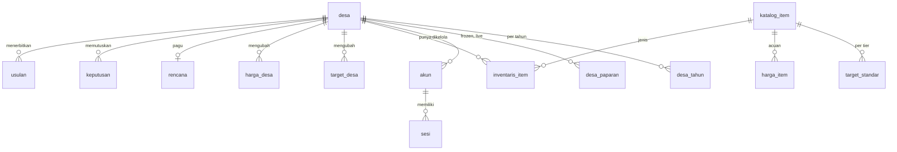

# 05 — Backend Schema Document: SiapKemarau

> Dibutuhkan, karena aplikasi menyimpan inventaris, keputusan, dan usulan per desa. `db/schema.sql` di repositori adalah salinan persis dari DDL di bawah dan menjadi satu-satunya sumber skema. Dialek: SQLite/libSQL.

## 1. Kepemilikan tabel

| Kelompok | Tabel | Ditulis oleh | Akses aplikasi |
|---|---|---|---|
| Referensi | `meta`, `sumber_data`, `dq_issue`, `katalog_item`, `target_standar`, `harga_item` | Pipeline | Baca |
| Wilayah dan paparan | `desa`, `desa_tahun`, `desa_paparan`, `kecamatan_paparan`, `kecamatan_bulan` | Pipeline | Baca |
| Bukti | `backtest_metric`, `backtest_grup` | Pipeline | Baca |
| Akun | `akun`, `sesi`, `rate_limit` | Aplikasi dan seed | Tulis |
| Desa | `inventaris_item`, `target_desa`, `harga_desa`, `rencana`, `keputusan`, `usulan` | Aplikasi | Tulis |
| Jejak | `audit_log` | Aplikasi | Tulis |

Menjalankan ulang pipeline membuat `data/siapkemarau.db` baru. Karena itu seed akun dijalankan sesudah pipeline.

## 2. Relasi



## 3. DDL

```sql
PRAGMA foreign_keys = ON;

-- Referensi
CREATE TABLE meta (
  kunci TEXT PRIMARY KEY,
  nilai TEXT NOT NULL
);

CREATE TABLE sumber_data (
  kode TEXT PRIMARY KEY,
  nama TEXT NOT NULL,
  url TEXT NOT NULL,
  lisensi TEXT NOT NULL,
  periode TEXT NOT NULL,
  diakses TEXT NOT NULL
);

CREATE TABLE dq_issue (
  kode TEXT PRIMARY KEY,
  judul TEXT NOT NULL,
  isi TEXT NOT NULL,
  tingkat TEXT NOT NULL CHECK (tingkat IN ('info','peringatan','batasan')),
  sumber_url TEXT
);

CREATE TABLE katalog_item (
  kode TEXT PRIMARY KEY,
  nama TEXT NOT NULL,
  satuan TEXT NOT NULL,
  bobot REAL NOT NULL CHECK (bobot > 0),
  kritis INTEGER NOT NULL CHECK (kritis IN (0,1)),
  bisa_dibeli INTEGER NOT NULL CHECK (bisa_dibeli IN (0,1)),
  hanya_gambut INTEGER NOT NULL DEFAULT 0 CHECK (hanya_gambut IN (0,1)),
  urutan INTEGER NOT NULL
);

CREATE TABLE target_standar (
  item_kode TEXT NOT NULL REFERENCES katalog_item(kode),
  tier TEXT NOT NULL CHECK (tier IN ('rendah','sedang','tinggi')),
  target REAL NOT NULL CHECK (target >= 0),
  sumber TEXT NOT NULL,
  PRIMARY KEY (item_kode, tier)
);

CREATE TABLE harga_item (
  item_kode TEXT NOT NULL REFERENCES katalog_item(kode),
  aksi TEXT NOT NULL CHECK (aksi IN ('perbaiki','beli')),
  harga_rp INTEGER NOT NULL CHECK (harga_rp > 0),
  sumber TEXT NOT NULL,
  tanggal TEXT NOT NULL,
  catatan TEXT,
  PRIMARY KEY (item_kode, aksi)
);

-- Wilayah dan paparan
CREATE TABLE desa (
  kode TEXT PRIMARY KEY,
  nama TEXT NOT NULL,
  kec_kode TEXT NOT NULL,
  kec_nama TEXT NOT NULL,
  kab_kode TEXT NOT NULL,
  kab_nama TEXT NOT NULL,
  prov_kode TEXT NOT NULL,
  prov_nama TEXT NOT NULL,
  lat REAL NOT NULL,
  lon REAL NOT NULL,
  luas_ha REAL NOT NULL,
  peat_frac REAL NOT NULL CHECK (peat_frac BETWEEN 0 AND 1),
  geom_json TEXT NOT NULL
);
CREATE INDEX idx_desa_nama ON desa(nama COLLATE NOCASE);
CREATE INDEX idx_desa_kec ON desa(kec_kode);

CREATE TABLE desa_tahun (
  kode TEXT NOT NULL REFERENCES desa(kode),
  tahun INTEGER NOT NULL,
  n_det INTEGER NOT NULL,
  det_days INTEGER NOT NULL,
  terpapar INTEGER NOT NULL CHECK (terpapar IN (0,1)),
  PRIMARY KEY (kode, tahun)
);

CREATE TABLE desa_paparan (
  kode TEXT NOT NULL REFERENCES desa(kode),
  mode TEXT NOT NULL CHECK (mode IN ('frozen','live')),
  k_ext INTEGER NOT NULL,
  n_ext INTEGER NOT NULL,
  k_norm INTEGER NOT NULL,
  n_norm INTEGER NOT NULL,
  tahun_tenang INTEGER NOT NULL,
  tampak_aman INTEGER NOT NULL CHECK (tampak_aman IN (0,1)),
  tier TEXT NOT NULL CHECK (tier IN ('rendah','sedang','tinggi')),
  skor REAL NOT NULL,
  PRIMARY KEY (kode, mode)
);

CREATE TABLE kecamatan_paparan (
  kec_kode TEXT NOT NULL,
  mode TEXT NOT NULL CHECK (mode IN ('frozen','live')),
  n_desa INTEGER NOT NULL,
  k INTEGER NOT NULL,
  n INTEGER NOT NULL,
  p_mean REAL NOT NULL,
  p05 REAL NOT NULL,
  p95 REAL NOT NULL,
  PRIMARY KEY (kec_kode, mode)
);

CREATE TABLE kecamatan_bulan (
  kec_kode TEXT NOT NULL,
  bulan INTEGER NOT NULL CHECK (bulan BETWEEN 1 AND 12),
  n_det INTEGER NOT NULL,
  PRIMARY KEY (kec_kode, bulan)
);

-- Bukti
CREATE TABLE backtest_metric (
  unit TEXT NOT NULL CHECK (unit IN ('desa','kecamatan')),
  strategi TEXT NOT NULL CHECK (strategi IN ('paparan','persistensi','gambut','acak')),
  metrik TEXT NOT NULL,
  nilai REAL NOT NULL,
  PRIMARY KEY (unit, strategi, metrik)
);

CREATE TABLE backtest_grup (
  grup TEXT PRIMARY KEY CHECK (grup IN ('tampak_aman','aktif','tanpa_riwayat_ekstrem')),
  n_desa INTEGER NOT NULL,
  n_terpapar_2026 INTEGER NOT NULL,
  rate REAL NOT NULL
);

-- Akun
CREATE TABLE akun (
  id INTEGER PRIMARY KEY,
  username TEXT NOT NULL UNIQUE,
  pass_hash TEXT NOT NULL,
  peran TEXT NOT NULL CHECK (peran IN ('mpa','desa')),
  desa_kode TEXT NOT NULL REFERENCES desa(kode),
  nama_tampil TEXT NOT NULL,
  is_demo INTEGER NOT NULL DEFAULT 0 CHECK (is_demo IN (0,1))
);

CREATE TABLE sesi (
  token_hash TEXT PRIMARY KEY,
  akun_id INTEGER NOT NULL REFERENCES akun(id) ON DELETE CASCADE,
  expires_at TEXT NOT NULL
);

CREATE TABLE rate_limit (
  kunci TEXT NOT NULL,
  jendela TEXT NOT NULL,
  jumlah INTEGER NOT NULL,
  PRIMARY KEY (kunci, jendela)
);

-- Desa
CREATE TABLE inventaris_item (
  desa_kode TEXT NOT NULL REFERENCES desa(kode),
  item_kode TEXT NOT NULL REFERENCES katalog_item(kode),
  total REAL NOT NULL CHECK (total >= 0),
  berfungsi REAL NOT NULL CHECK (berfungsi >= 0 AND berfungsi <= total),
  catatan TEXT,
  updated_by INTEGER NOT NULL REFERENCES akun(id),
  updated_at TEXT NOT NULL,
  PRIMARY KEY (desa_kode, item_kode)
);

CREATE TABLE target_desa (
  desa_kode TEXT NOT NULL REFERENCES desa(kode),
  item_kode TEXT NOT NULL REFERENCES katalog_item(kode),
  target REAL NOT NULL CHECK (target >= 0),
  alasan TEXT NOT NULL CHECK (length(alasan) >= 5),
  updated_by INTEGER NOT NULL REFERENCES akun(id),
  updated_at TEXT NOT NULL,
  PRIMARY KEY (desa_kode, item_kode)
);

CREATE TABLE harga_desa (
  desa_kode TEXT NOT NULL REFERENCES desa(kode),
  item_kode TEXT NOT NULL REFERENCES katalog_item(kode),
  aksi TEXT NOT NULL CHECK (aksi IN ('perbaiki','beli')),
  harga_rp INTEGER NOT NULL CHECK (harga_rp > 0),
  sumber TEXT NOT NULL,
  updated_by INTEGER NOT NULL REFERENCES akun(id),
  updated_at TEXT NOT NULL,
  PRIMARY KEY (desa_kode, item_kode, aksi)
);

CREATE TABLE rencana (
  desa_kode TEXT PRIMARY KEY REFERENCES desa(kode),
  pagu_rp INTEGER NOT NULL CHECK (pagu_rp >= 0),
  updated_by INTEGER NOT NULL REFERENCES akun(id),
  updated_at TEXT NOT NULL
);

CREATE TABLE keputusan (
  desa_kode TEXT NOT NULL REFERENCES desa(kode),
  item_kode TEXT NOT NULL REFERENCES katalog_item(kode),
  aksi TEXT NOT NULL CHECK (aksi IN ('perbaiki','beli')),
  keputusan TEXT NOT NULL CHECK (keputusan IN ('setuju','tolak','tunda')),
  catatan TEXT,
  updated_by INTEGER NOT NULL REFERENCES akun(id),
  updated_at TEXT NOT NULL,
  PRIMARY KEY (desa_kode, item_kode, aksi)
);

CREATE TABLE usulan (
  id INTEGER PRIMARY KEY,
  desa_kode TEXT NOT NULL REFERENCES desa(kode),
  kanal TEXT NOT NULL CHECK (kanal IN ('apbdes_perubahan','bpbd','daops','csr')),
  facts_json TEXT NOT NULL,
  baris_json TEXT NOT NULL,
  teks TEXT NOT NULL,
  sumber_teks TEXT NOT NULL CHECK (sumber_teks IN ('ai','template')),
  model TEXT,
  created_by INTEGER NOT NULL REFERENCES akun(id),
  created_at TEXT NOT NULL
);
CREATE INDEX idx_usulan_desa ON usulan(desa_kode, created_at);

-- Jejak
CREATE TABLE audit_log (
  id INTEGER PRIMARY KEY,
  akun_id INTEGER NOT NULL REFERENCES akun(id),
  desa_kode TEXT NOT NULL,
  aksi TEXT NOT NULL,
  detail_json TEXT NOT NULL,
  created_at TEXT NOT NULL
);
```

## 4. Aturan data

| Aturan | Penegakan |
|---|---|
| Berfungsi tidak melebihi total | `CHECK` dan zod |
| Waktu | ISO 8601 UTC, `2026-11-12T03:15:00Z`. Tampilan WIB |
| Rupiah | Bilangan bulat |
| Boolean | 0 atau 1 |
| Pipeline tidak menyentuh tabel desa | Tabel desa dibuat kosong oleh `export.py` |
| `usulan` tidak berubah | Tidak ada endpoint ubah. Terbitkan baru untuk memperbarui |
| Tidak ada data pribadi anggota | `catatan` diberi petunjuk UI agar tidak memuat nama atau NIK |

## 5. Kueri efektif

**Target efektif** untuk desa dan tier:

```sql
SELECT k.kode AS item_kode,
       COALESCE(td.target, ts.target) AS target,
       CASE WHEN td.target IS NULL THEN ts.sumber ELSE 'Diubah desa: ' || td.alasan END AS sumber
FROM katalog_item k
JOIN target_standar ts ON ts.item_kode = k.kode AND ts.tier = :tier
LEFT JOIN target_desa td ON td.item_kode = k.kode AND td.desa_kode = :kode
WHERE k.hanya_gambut = 0 OR :peat_frac > 0
ORDER BY k.urutan;
```

**Harga efektif:** `harga_desa` menimpa `harga_item` untuk pasangan `(item_kode, aksi)` yang sama.

**Tier yang dipakai aplikasi:** `desa_paparan.tier` pada mode `live`.

## 6. Isi kontrol pipeline

`run_all.py` wajib mencetak angka berikut. Hasilnya menjadi angka kontrol di deck dan README.

- Jumlah desa per provinsi dan jumlah desa dengan `peat_frac > 0`.
- Jumlah deteksi sebelum dan sesudah filter confidence.
- Jumlah desa-tahun terpapar per tahun.
- Isi `backtest_grup`, capture top-K per strategi, hasil `gate`.
- Riwayat `desa_tahun` Desa Kalibandung.
- Ukuran file DB.

## 7. Data awal

| Tabel | Sumber | Catatan |
|---|---|---|
| `katalog_item`, `target_standar` | `data/manual/*.csv` | Nilai dari PRD bagian 6 |
| `harga_item` | `data/manual/harga_item.csv` | Baris wajib bersumber. Tabel boleh kosong sebagian |
| `sumber_data`, `dq_issue` | `data/manual/*.csv` | Minimal memuat empat batasan pada FR-05 |
| `akun` demo | `scripts/seed-accounts.ts` | `demo-mpa` dan `demo-sekdes`, satu desa, `is_demo = 1` |

## 8. Bentuk fakta usulan

`usulan.facts_json` adalah peta string agar bisa langsung mengisi placeholder.

```json
{
  "desa": "Contoh Desa",
  "kecamatan": "Contoh Kecamatan",
  "kabupaten": "Contoh Kabupaten",
  "skor": "41,7",
  "status": "sebagian",
  "rantai_terlemah": "Selang keluar",
  "paparan": "3 dari 4 tahun kering ekstrem",
  "tahun_tenang": "6",
  "pagu": "Rp7.000.000",
  "total_usulan": "Rp6.000.000",
  "skor_sesudah": "83,3",
  "tanggal": "12 November 2026"
}
```

Nilai di atas sintetis, hanya menunjukkan bentuk.
