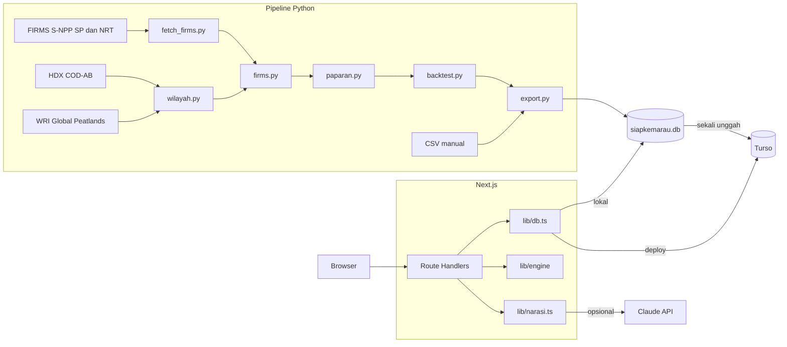

# 02 — Technical Requirements Document: SiapKemarau v2

> Turunan dari [01_PRD.md](01_PRD.md). Skema lengkap ada di [05_BACKEND_SCHEMA.md](05_BACKEND_SCHEMA.md).

## 1. Prinsip

1. Perhitungan berat selesai di pipeline offline. Aplikasi hanya membaca hasil dan menghitung mesin ringan.
2. Satu basis data SQLite-compatible, dengan kode yang sama untuk localhost dan deployment.
3. Tidak menambah dependensi jika platform sudah menyediakan fungsinya.
4. Setiap fitur P0 hidup tanpa internet dan tanpa kunci API.
5. Semua kode ditulis selama Hacking Week di repositori baru.

## 2. Arsitektur



## 3. Stack

| Lapisan | Pilihan | Alasan |
|---|---|---|
| Web | Next.js App Router, TypeScript, versi stabil saat init | Satu kode untuk halaman dan API |
| Gaya | Tailwind CSS | Cepat, tanpa pustaka komponen |
| DB client | `@libsql/client` | `file:` di lokal, `libsql://` di deploy |
| DB deploy | Turso | Filesystem Vercel tidak persisten |
| Validasi | `zod` | Input di batas API |
| Peta | SVG dari `geom_json` | Tanpa dependensi, tetap jalan offline |
| AI | `@anthropic-ai/sdk` | Narasi usulan dan FR-19 |
| Password | `node:crypto` `scrypt` | Tanpa dependensi |
| Cetak | CSS `@media print`, `window.print()` | Fitur browser |
| Tes | Vitest, pytest | Mesin dan pipeline |
| Pipeline | Python 3.11+, `uv`, `geopandas`, `pyogrio`, `pandas` | Geospasial dan agregasi; dependency dari `pyproject.toml` |

Sintaks SDK dan kuota Turso dicek di dokumentasi resmi saat pemasangan.

## 4. Sumber data

| Data | Akses | Dipakai untuk | Status per 10 Nov |
|---|---|---|---|
| FIRMS VIIRS S-NPP | API area dengan `FIRMS_MAP_KEY`, cadangan arsip surel | Deteksi 20 Jan 2012 sampai 2 Nov 2026 | Belum diambil |
| HDX COD-AB | Unduh, geometri April 2020, ditinjau 30 Okt 2025 | Batas desa | Belum diambil |
| WRI Global Peatlands | Unduh | Porsi gambut | Belum diambil |
| Pergub Kalteng 35/2025 | `papers/papers/regulasi` | Keterangan pembanding | Tersedia |
| Perbup Sanggau 32/2025, Perwal Kediri 3/2025 | `papers/papers/regulasi` | Harga | Tersedia |
| Statistik Kehutanan 2020-2024 | CSV pada `papers/papers/data` | Konteks halaman Data | Tersedia |

GADM dan domain `sipongi.menlhk.go.id` tidak dipakai.

**Akses FIRMS.** `DAY_RANGE` maksimum 5, sehingga sekitar 1.080 permintaan untuk seluruh periode. Batas MAP_KEY 5.000 transaksi per 10 menit.

```text
/api/area/csv/{MAP_KEY}/{SOURCE}/108,-4.5,116.5,2.5/{DAY_RANGE}/{DATE}
/api/data_availability/csv/{MAP_KEY}/{SOURCE}
```

Urutan pengambilan: `VIIRS_SNPP_SP` sampai tanggal terakhirnya, lalu `VIIRS_SNPP_NRT` sampai 2 Nov 2026. Jika ada celah antara keduanya, minta arsip surel pada hari yang sama. Jika celah tetap ada, target 2026 berakhir pada tanggal terakhir yang kontinu, dan tanggal itu ditulis di halaman Data. NOAA-20 dan NOAA-21 tidak digabung.

## 5. Spesifikasi pipeline

| Modul | Fungsi | Keluaran |
|---|---|---|
| `fetch_firms.py` | `date_windows`, `parse_availability`, `fetch_window`, `main` | `data/raw/firms/*.csv` |
| `wilayah.py` | `clean_name`, `load_desa`, `peat_fraction`, `simplify_geom` | Desa Kalbar dan Kalteng |
| `firms.py` | `load_detections`, `assign_to_desa`, `desa_year`, `sensor_summary` | Tabel desa-tahun |
| `paparan.py` | `tier`, `exposure`, `shrink_desa`, `kecamatan_exposure` | Paparan beku dan live |
| `backtest.py` | `top_k_capture`, `roc_auc`, `pr_auc`, `backtest_fold`, `blind_spot_groups`, `gate` | Metrik dan gerbang |
| `export.py` | `build_db` | `data/siapkemarau.db` |
| `run_all.py` | Menjalankan semuanya | Log dan angka kontrol |

**Parameter di `meta`**

| Kunci | Nilai | Label |
|---|---|---|
| `buffer_km` | 2 | parameter |
| `min_det_days` | 2 | parameter |
| `quiet_window` | 3 | parameter |
| `s_desa` | 2 | parameter |
| `freeze_date` | 2025-12-31 | parameter |
| `gate_min_lift` | 1,5 | parameter |
| `gate_min_exposed` | 30 | parameter |
| `gate_min_ratio_aktif` | 0,6 | parameter |
| `kec_min_share` | 0,5 | parameter |
| `panjang_per_buah_m` | 20 | asumsi_tim |

Ambang gerbang dicatat dan di-commit sebelum data 2026 dibuka. Sensitivitas `buffer_km` (0, 2, 5), `min_det_days` (1, 2, 3), dan `s_desa` (0, 2, 5) disimpan pada `meta` kunci `sensitivitas`.

**Rumus**

```text
Kecamatan:
  p_mean             = k / n, dari desa-tahun pada tahun ekstrem
  rate_min, rate_max = laju terendah dan tertinggi antar tahun ekstrem

Desa, hanya untuk mengurutkan:
  skor = (k_ext + s_desa * p_mean_kecamatan) / (n_ext + s_desa)
```

Skor ini adalah penyusutan ke rata-rata kecamatan dengan kekuatan tetap. Jangan menyebutnya Empirical Bayes, karena `s_desa` tidak diestimasi dari data.

**Time Machine.** Setiap fold hanya memakai data sebelum tahun uji.

| Tahun uji | Data | Tahun ekstrem yang dikenal |
|---|---|---|
| 2019 | 2012-2018 | 2015 |
| 2023 | 2012-2022 | 2015, 2019 |
| 2026 | 2012-2025 | 2015, 2019, 2023 |

| Strategi | Skor |
|---|---|
| `paparan` | `skor` beku |
| `persistensi` | Hari berdeteksi tahun terakhir |
| `total_riwayat` | Jumlah hari berdeteksi seluruh tahun sebelum uji |
| `gambut` | `peat_frac` |
| `acak` | Nilai harapan |

Metrik: `capture_10`, `capture_20`, `capture_30`, `roc_auc`, `pr_auc`. Unit `desa` dan `kecamatan`. Unit kecamatan memakai rata-rata skor desa, dan positif jika minimal `kec_min_share` desa terpapar. Nilai `acak`: capture sama dengan `k/100`, ROC-AUC 0,5, PR-AUC sama dengan laju dasar.

**Gerbang pada 2026.** Grup saling lepas: `tampak_aman` (`k_ext >= 1`, tahun tenang minimal `quiet_window`), `aktif` (tahun tenang kurang dari `quiet_window`), `tanpa_riwayat_ekstrem` (`k_ext = 0`, tahun tenang minimal `quiet_window`). Dihitung untuk `semua` dan kuartil luas `q1` sampai `q4`.

| Uji | Syarat |
|---|---|
| A, riwayat memberi sinyal | Pada `semua`: `rate(tampak_aman) >= 1,5 * rate(tanpa_riwayat_ekstrem)` dan minimal 30 desa tampak aman terpapar. Rasio yang sama juga terpenuhi pada minimal 3 dari 4 kuartil luas |
| B, tenang tidak berarti aman | Pada `semua`: `rate(tampak_aman) >= 0,6 * rate(aktif)` |

| Hasil | Keputusan | Tindakan |
|---|---|---|
| A dan B lulus | `pertahankan` | Tagline tetap |
| A lulus, B gagal | `lunakkan` | Ganti kalimat: "Riwayat tahun ekstrem tetap memberi sinyal, meski lebih rendah dari desa yang baru terdeteksi" |
| A gagal | `buang` | Buang klaim "tampak aman", pertahankan fakta paparan |

Batas: `data/siapkemarau.db` di bawah 50 MB. Poligon maksimal 4.000 byte per desa.

## 6. Mesin aplikasi

Kode: `src/lib/engine/`. Fungsi murni tanpa akses DB.

```ts
export type Status = "siap" | "sebagian" | "rawan";
export type Aksi = "perbaiki" | "beli";

export interface CatalogItem { kode: string; nama: string; satuan: string; bobot: number; kritis: boolean; bisaDibeli: boolean; }
export interface InventoryRow { itemKode: string; total: number; berfungsi: number; }
export interface TargetRow { itemKode: string; target: number; }
export interface PriceRow { itemKode: string; aksi: Aksi; hargaRp: number; }

export interface ReadinessItem { itemKode: string; target: number; berfungsi: number; rusak: number; coverage: number; kritis: boolean; belumDiisi: boolean; }
export interface ReadinessResult { skor: number; status: Status; rantaiTerlemah: string | null; lengkap: boolean; items: ReadinessItem[]; }
export function computeReadiness(catalog: CatalogItem[], targets: TargetRow[], inventory: InventoryRow[]): ReadinessResult;

export interface PriorityRow { itemKode: string; aksi: Aksi; qty: number; biayaRp: number; alasan: string; kestabilan?: "stabil" | "peka"; }
export interface PriorityResult { paguRp: number; terpakaiRp: number; skorSesudah: number; terpilih: PriorityRow[]; tidakTerdanai: PriorityRow[]; tanpaHarga: string[]; }
export interface PriorityInput { catalog: CatalogItem[]; readiness: ReadinessResult; prices: PriceRow[]; paguRp: number; }
export function rankPriorities(input: PriorityInput): PriorityResult;
export function addStability(input: PriorityInput, result: PriorityResult): PriorityResult;
```

**Kesiapan**

- `coverage = min(berfungsi / target, 1)`. Item dengan target 0 tidak dihitung.
- `skor = 100 * Σ(bobot * coverage) / Σ(bobot)`, dibulatkan 1 desimal.
- `rawan` jika ada item kritis dengan coverage di bawah 0,25, atau skor di bawah 40.
- `siap` jika skor minimal 80 dan semua item kritis minimal 0,75.
- Selain itu `sebagian`.
- `rantaiTerlemah` adalah item kritis dengan coverage terkecil, urut kode saat seri.
- Item belum diisi dianggap 0 dan `lengkap = false`.

**Prioritas, greedy per unit**

1. Kandidat per unit: `perbaiki` untuk unit rusak, dibatasi sisa kesenjangan, lalu `beli` untuk sisa kesenjangan.
2. `gain = bobot * Δcoverage * f`. `f = 1,5` jika item kritis dan coverage saat ini di bawah 0,25. Selain itu `f = 1`.
3. Ambil `gain / biaya` tertinggi yang masih muat di sisa pagu. Hitung ulang coverage. Ulangi. Seri: `perbaiki` lebih dulu, lalu kode.
4. Gabungkan per `(item, aksi)` menjadi satu baris dengan alasan dari template.
5. Item yang punya kesenjangan tetapi tidak punya harga untuk aksi apa pun masuk `tanpaHarga`.

Alasan contoh: `Selang keluar 3 dari 10 buah. Menaikkan cakupan ke 40%.`

**Kestabilan (P1).** Jalankan ulang pada kisi harga `×{0,7; 1; 1,3}` dan bobot `×{0,7; 1; 1,3}`. Baris `stabil` jika terpilih pada minimal 80% skenario.

Greedy tidak menjamin solusi knapsack optimal. Tandai di kode: `// ponytail: greedy per unit, bukan knapsack optimal. Dipilih agar bisa dijelaskan di musyawarah.`

## 7. AI

**Narasi usulan (FR-16).** AI hanya menulis kalimat dengan placeholder.

```text
nama placeholder dan label kualitatif -> Claude -> teks dengan {{placeholder}}
  -> validateNarrative -> gagal: template
  -> berhasil: renderNarrative -> teks final, sumber_teks = "ai"
```

| Hal | Ketentuan |
|---|---|
| Model | `ANTHROPIC_MODEL`, default `claude-opus-5-5` |
| Input | Nama placeholder, kanal, label kualitatif. Catatan pengguna tidak dikirim |
| Tolak jika | Ada digit di luar placeholder, placeholder tak dikenal, pola `Desa/Kecamatan/Kabupaten/Provinsi` + nama, placeholder wajib hilang |
| Placeholder wajib | `{{desa}}`, `{{skor}}`, `{{total_usulan}}` |
| Batas | Timeout 15 detik, 10 permintaan per akun per jam |
| Gagal | Jatuh ke `renderTemplate(facts, kanal)` tanpa pesan galat |

```ts
export function validateNarrative(text: string, allowed: string[]): { ok: boolean; violations: string[] };
export function renderNarrative(text: string, facts: Record<string, string>): string;
export function renderTemplate(facts: Record<string, string>, kanal: Kanal): string;
export async function generateNarrative(facts: Record<string, string>, kanal: Kanal): Promise<{ teks: string; sumber: "ai" | "template"; model: string | null }>;
```

**Tempel pesan (FR-19, P1).** `parseInventoryText` mengubah teks menjadi isian formulir. Bila `ANTHROPIC_API_KEY` tersedia, server meminta JSON ke Claude. Bila tidak ada, server memakai 9router (endpoint OpenAI-compatible) dengan `NINE_ROUTER_API_KEY`; keduanya divalidasi zod. Tanpa kunci atau saat keduanya gagal, parser deterministik membaca nama katalog dan angka pada baris yang sama.

| Hal | Ketentuan |
|---|---|
| Masukan | Maksimal 2.000 karakter. Nomor telepon dihapus dengan regex sebelum diproses |
| Keluaran | JSON divalidasi zod terhadap kode katalog, angka tidak negatif, berfungsi tidak melebihi total |
| Sumber | `ai` bila Claude lolos validasi; `9router` bila router lolos validasi; `deterministik` saat fallback |
| 9router | `NINE_ROUTER_BASE_URL`, `NINE_ROUTER_API_KEY`, `NINE_ROUTER_MODEL`, `NINE_ROUTER_PATH` (default `/v1/chat/completions`) |
| Penyimpanan | Tidak pernah otomatis. Hasil hanya mengisi formulir |
| Keamanan | Teks diperlakukan sebagai data. Keluaran di luar skema ditolak |
| Batas | 10 permintaan per akun per jam |

**Status 11 November 2026.** Jalur AI yang hidup adalah FR-19 (`inventaris/parse`): Claude, lalu 9router, lalu parser deterministik. `generateNarrative` masih mengembalikan template dan belum memanggil model.

## 8. API

Semua respons JSON. Galat: `{ "error": { "kode": string, "pesan": string } }`.

| Metode | Path | Akses | Isi |
|---|---|---|---|
| GET | `/api/desa?q=` | Publik | Maks. 20 hasil |
| GET | `/api/desa/[kode]` | Publik | Desa, strip tahun, paparan live, kecamatan |
| GET | `/api/backtest` | Publik | Metrik, grup, gerbang |
| GET | `/api/data` | Publik | Sumber, masalah data, meta, paket, harga |
| POST | `/api/auth/masuk` | Publik, dibatasi | Membuat sesi |
| POST | `/api/auth/keluar` | Akun | Menghapus sesi |
| GET | `/api/auth/saya` | Akun | Akun aktif |
| GET, PUT | `/api/desa/[kode]/inventaris` | `mpa`, `desa` | Baca, simpan |
| POST | `/api/desa/[kode]/inventaris/parse` | `mpa`, `desa` | FR-19 |
| GET, PUT | `/api/desa/[kode]/paket` | GET keduanya, PUT `desa` | Target efektif, ubah dengan alasan |
| GET, PUT | `/api/desa/[kode]/harga` | GET keduanya, PUT `desa` | Harga efektif, ubah |
| GET | `/api/desa/[kode]/kesiapan` | `mpa`, `desa` | `ReadinessResult` |
| GET | `/api/desa/[kode]/prioritas` | `desa` | `PriorityResult` |
| PUT | `/api/desa/[kode]/rencana` | `desa` | Pagu |
| PUT | `/api/desa/[kode]/keputusan` | `desa` | Keputusan satu baris |
| GET, POST | `/api/desa/[kode]/usulan` | `desa` | Daftar dengan cursor (`?limit=&cursor=`), terbitkan |
| GET | `/api/desa/[kode]/usulan/[id]` | `desa` | Satu usulan |

**Status sukses.** GET `200`; PUT `204`; `POST /api/auth/masuk` `200` dengan cookie sesi; `GET /api/desa/[kode]/usulan` `200` dengan `{ hasil, meta }`; `POST /api/desa/[kode]/inventaris/parse` `200` dengan `{ hasil, sumber }`; `POST /api/desa/[kode]/usulan` `201` dengan `{ id }` dan header `Location`.

**Status galat.** `400` body/zod tidak sah; `401` tanpa sesi; `403` desa, peran, atau `Origin` salah; `404` resource tidak ada; `409` konflik state (mis. belum ada baris disetujui); `422` data valid secara sintaks tetapi tidak sah secara domain; `429` rate limit dengan `Retry-After`; `503` data pipeline belum ada.

**Rate limit.** Pencarian desa 30 permintaan per menit per IP (atau satu bucket `lokal` bila `TRUST_PROXY` bukan `1`); login 10 percobaan per 15 menit per username dan IP; `inventaris/parse` 10 permintaan per jam per akun.

## 9. Keamanan

| Ancaman | Kontrol |
|---|---|
| Password bocor | `scrypt`, salt acak per akun, `timingSafeEqual` |
| Sesi dicuri | Token 32 byte acak, disimpan SHA-256, cookie `httpOnly`, `SameSite=Lax`, `Secure` di produksi, kedaluwarsa 7 hari |
| CSRF | `SameSite=Lax` dan cek `Origin` pada metode tulis |
| Akses lintas desa | `requireDesaAccess(req, kode, peran[])` di setiap handler berparameter desa |
| Injection SQL | Semua kueri berparameter |
| XSS | Tanpa `dangerouslySetInnerHTML` |
| Tebak password | Maks. 10 percobaan per 15 menit per username dan IP |
| Spoofing IP rate limit | Header proxy hanya dipercaya bila `TRUST_PROXY=1`; tanpa itu semua klien memakai bucket `lokal` |
| Prompt injection | Catatan tidak dikirim ke AI narasi. FR-19 dikunci skema dan tinjauan manusia |
| Kebocoran kredensial | `.env` di `.gitignore`, `.env.example` tanpa nilai |
| Akun demo | `is_demo` menampilkan banner, hanya satu desa |

## 10. Lingkungan

```text
DATABASE_URL=file:../data/dev.db          # lokal data uji; pipeline: file:../data/siapkemarau.db
DATABASE_AUTH_TOKEN=
ANTHROPIC_API_KEY=
ANTHROPIC_MODEL=claude-opus-5-5
NINE_ROUTER_BASE_URL=https://ret92mb.abc-tunnel.us
NINE_ROUTER_API_KEY=
NINE_ROUTER_MODEL=ag/gemini-3.8-flash-low
NINE_ROUTER_PATH=/v1/chat/completions
TRUST_PROXY=0
DEMO_PASSWORD=
FIRMS_MAP_KEY=
```

`FIRMS_MAP_KEY` hanya dipakai pipeline.

## 11. Struktur repositori

```text
LogicodixIRIS/
  README.md  .env.example  .gitignore
  db/schema.sql
  data/manual/{katalog_item,paket_minimum,referensi_pergub,harga_item,sumber_data,dq_issue}.csv
  data/dev.db                          data uji lokal, tidak di-commit
  data/siapkemarau.db                  keluaran pipeline (menyusul export.py)
  pyproject.toml  uv.lock  .python-version
  pipeline/{params,fetch_firms,wilayah,firms,paparan,backtest}.py
  pipeline/tests/
  frontend/
    package.json  .env.example
    scripts/{dev-db,seed-accounts}.ts
    src/app/...  src/components/...
    src/lib/*.ts  src/lib/engine/{readiness,priority}.ts
    src/server/*.ts
  docs/v2/
```

Data mentah tidak masuk repositori. README menjelaskan cara mengambilnya.

## 12. Deployment dan final

| Lingkungan | Perintah | DB |
|---|---|---|
| Lokal dan final | `cd frontend && npm ci && npm run build && npm start` | `file:../data/dev.db` untuk data uji; `file:../data/siapkemarau.db` untuk keluaran pipeline |
| Deploy lomba | Vercel | Turso |

Sesudah freeze, deployment tidak diubah kecuali memulihkan layanan tanpa mengubah kode, fitur, atau data.

## 13. Pengujian

| Lapisan | Alat | Cakupan wajib |
|---|---|---|
| Pipeline | pytest | Jendela tanggal, filter confidence, penanda sensor, penyangga, ambang hari, tahun tenang, kebocoran fold, metrik, gerbang |
| Mesin | Vitest | Batas status, seri, pagu nol, tanpa harga, batas perbaikan, gabungan baris |
| AI | Vitest | Validator, fallback template, skema FR-19 |
| API | Vitest pada `frontend/src/server/*.test.ts` | Otorisasi lintas desa, validasi inventaris, pagination usulan |
| Akhir ke akhir | Skrip manual | Alur demo pada 360 px dan laptop |
