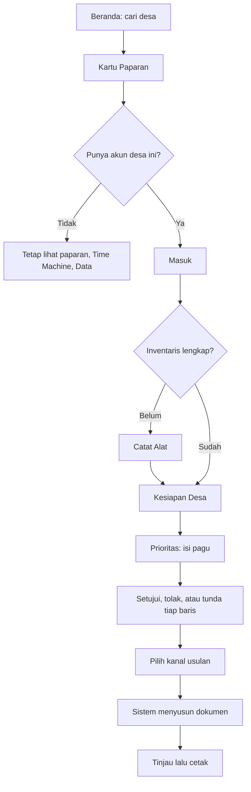

# 03 — App Flow Document: SiapKemarau v2

> Turunan dari [01_PRD.md](01_PRD.md). Endpoint ada di [02_TRD.md](02_TRD.md) bagian 8.

## 1. Peta halaman

| Path | Nama | Akses | FR | Pemilik |
|---|---|---|---|---|
| `/` | Beranda dan pencarian desa | Publik | FR-01 | Orang 1 |
| `/desa/[kode]` | Kartu Paparan | Publik | FR-02, FR-03 | Orang 1 |
| `/time-machine` | Time Machine | Publik | FR-04 | Orang 1 |
| `/data` | Data dan Asumsi | Publik | FR-05 | Orang 1 |
| `/masuk` | Masuk | Publik | FR-06 | Orang 2 |
| `/desa/[kode]/kesiapan` | **Kesiapan Desa (hero)** | `mpa`, `desa` | FR-10 | Orang 2 |
| `/desa/[kode]/inventaris` | Catat Alat | `mpa`, `desa` | FR-07, FR-19 | Orang 2 |
| `/desa/[kode]/prioritas` | Prioritas | `desa` | FR-09, FR-11 sampai FR-14 | Orang 2 |
| `/desa/[kode]/usulan` | Daftar dan Terbitkan Usulan | `desa` | FR-15 | Orang 2 |
| `/desa/[kode]/usulan/[id]` | Dokumen Usulan dan Cetak | `desa` | FR-15, FR-16 | Orang 2 |

Navigasi bawah pada HP sesudah masuk: **Kesiapan, Alat, Prioritas, Usulan**. Akun `mpa` hanya melihat Kesiapan dan Alat.

## 2. Alur utama

## 3. Detail layar

### 3.1 Beranda `/`

| Unsur | Isi |
|---|---|
| Judul | Satu kalimat produk. Tagline hanya jika keputusan gerbang `pertahankan` |
| Kotak cari | Mencari setelah 2 karakter, jeda 250 ms |
| Angka | Jumlah desa tampak aman di wilayah cakupan. Disembunyikan jika keputusan `buang` |
| Catatan | "Berbasis data publik, belum diuji pengguna." |
| Tautan | Time Machine, Data dan Asumsi |

| Keadaan | Tampilan |
|---|---|
| Tidak ada hasil | "Desa tidak ditemukan. Cakupan saat ini Kalimantan Barat dan Kalimantan Tengah." |
| Di bawah 2 karakter | Petunjuk pencarian |
| Gagal jaringan | Pesan dan tombol coba lagi |

### 3.2 Kartu Paparan `/desa/[kode]`

Urutan dari atas:

1. Nama desa, wilayah, dan luas.
2. **Kalimat utama**: "Terdeteksi satelit pada {k} dari {n} tahun kering ekstrem. {t} tahun terakhir tenang."
3. Label tingkat paparan, dan "Tampak aman" jika memenuhi serta keputusan gerbang bukan `buang`.
4. Strip 2012-2026, satu sel per tahun. Tahun ekstrem diberi penanda.
5. Laju kecamatan dan rentangnya (P1).
6. Porsi gambut.
7. Bentuk desa dari `geom_json` (P1).
8. Tombol **"Periksa kesiapan desa ini"**.
9. Catatan: "Deteksi satelit bukan hitungan kebakaran. Awan dan asap bisa menutupi api. Desa luas lebih mudah terdeteksi."

| Keadaan | Tampilan |
|---|---|
| Tidak pernah terdeteksi | "Belum ada deteksi satelit memenuhi ambang sejak 2012. Ini bukan jaminan aman." Label "Tampak aman" tidak dipakai |
| Kode tidak ada | Halaman 404 dengan tautan ke pencarian |

### 3.3 Time Machine `/time-machine`

1. Pernyataan: "Bayangkan hari ini 31 Desember 2025. Hanya data sampai tanggal itu yang dipakai."
2. Daftar 20 desa teratas menurut peringkat beku.
3. Tombol **"Buka 2026"** menampilkan deteksi nyata 2026 pada desa yang sama.
4. Tabel metrik per tahun uji 2019, 2023, 2026 dan strategi. Baris pemenang diberi tanda.
5. Tiga kartu grup dan hasil gerbang, termasuk per kuartil luas.
6. Bagian "Apa yang tidak bisa dibuktikan halaman ini": tidak mengukur hektare, target adalah deteksi satelit, 2026 di luar rezim normal, dan tanggal akhir data 2026.

Kesimpulan menyebut hasil apa adanya. Jika paparan kalah dari persistensi atau total riwayat, kalimatnya mengatakan itu.

### 3.4 Data dan Asumsi `/data`

| Bagian | Isi |
|---|---|
| Status produk | "Berbasis data publik, belum diuji pengguna." |
| Sumber | Nama, lisensi, periode, tanggal akses |
| Sensor | Jumlah deteksi per tahun, satelit, dan sumber SP atau NRT |
| Batasan data | Dari `dq_issue` |
| Paket minimum dan harga | Nilai, sumber, label asumsi |
| Parameter | `meta` dan sensitivitas |
| Gerbang | Ambang dan hasil |
| AI | Model, bagian yang memakai, batasnya |

### 3.5 Masuk `/masuk`

Input username dan password. Berhasil menuju `/desa/[kode]/kesiapan`. Gagal: "Username atau password salah." Terlalu banyak percobaan: "Coba lagi dalam 15 menit."

### 3.6 Catat Alat `/desa/[kode]/inventaris`

Formulir satu kolom per item. Item dengan `punya_rusak = 0` (`dana_operasi`) hanya memiliki satu stepper. Item lain memiliki stepper total dan berfungsi. Tombol simpan menempel di bawah.

Selang tampil sebagai `3 / 10 buah`, dengan keterangan kecil `≈60 m pada asumsi 20 m per buah`.

| Validasi | Pesan |
|---|---|
| Berfungsi melebihi total | "Jumlah berfungsi tidak boleh melebihi jumlah total." |
| Negatif atau bukan angka | "Isi dengan angka 0 atau lebih." |

**Tempel pesan (P1).** Kotak teks dan tombol "Isi dari pesan". Hasil mengisi formulir dan menampilkan "Periksa dulu sebelum menyimpan."

### 3.7 Kesiapan Desa `/desa/[kode]/kesiapan` (hero)

1. Banner akun demo: "Akun demonstrasi. Isian alat adalah data uji, bukan survei lapangan."
2. **Gauge skor** dan status.
3. **Mata rantai terlemah**, satu kalimat.
4. Ringkasan paparan satu baris.
5. Item terurut dari kesenjangan terbesar.
6. Keterangan paket: "Paket minimum satu musim adalah asumsi tim dan bisa diubah desa."
7. Keterangan provinsi: angka Pergub untuk Kalteng, kalimat ketiadaan angka untuk Kalbar.
8. Tombol **"Susun prioritas"**, tidak tampil untuk akun `mpa`.

| Keadaan | Tampilan |
|---|---|
| Belum ada inventaris | Ajakan "Catat alat dulu" |
| Sebagian terisi | Skor dengan label "Belum lengkap" |

### 3.8 Prioritas `/desa/[kode]/prioritas`

1. Input pagu, default Rp15.000.000, dengan penggeser 0 sampai Rp100.000.000 dan kotak angka.
2. Ringkas: terpakai, sisa, skor sekarang menuju skor sesudah.
3. **Daftar terpilih**: urutan, aksi, item, jumlah, biaya, sumber harga, alasan, label kestabilan (P1), tombol Setuju/Tolak/Tunda.
4. Daftar tidak terdanai.
5. Item tanpa harga, dengan tombol isi harga.
6. Panel paket dan harga. Mengubah target wajib alasan. Mengubah harga wajib sumber.
7. Tombol **"Terbitkan usulan"**, aktif jika minimal satu baris disetujui.

| Keadaan | Tampilan |
|---|---|
| Pagu 0 | "Masukkan pagu untuk melihat urutan." |
| Pagu di bawah harga termurah | "Pagu belum cukup untuk satu item. Item termurah: {item}, {harga}." |
| Semua harga kosong | "Belum ada harga. Isi harga dari penawaran setempat." |

Keputusan tersimpan per `(item, aksi)` dan hanya berlaku pada baris yang masih terpilih.

### 3.9 Usulan `/desa/[kode]/usulan`

| Kanal | Sapaan | Penekanan |
|---|---|---|
| `apbdes_perubahan` | Musyawarah Desa | Pos belanja dan kesiapan |
| `bpbd` | Kepala BPBD Kabupaten | Paparan dan kesenjangan |
| `daops` | Kepala Daops Manggala Agni | Alat dan kesiapan regu |
| `csr` | Perusahaan sekitar | Daftar barang dan dampak kesiapan |

### 3.10 Dokumen Usulan `/desa/[kode]/usulan/[id]`

Isi: identitas desa, ringkasan paparan, kondisi kesiapan, tabel item disetujui dengan biaya dan alasan, narasi, kolom tanda tangan, lampiran sumber.

Wajib tampil:

- "Target, bobot, dan sebagian harga adalah asumsi tim, bukan standar yang mengikat desa. Dokumen wajib ditinjau manusia."
- Kanal `apbdes_perubahan`: "mengacu pada ketentuan fokus penggunaan Dana Desa yang berlaku pada Tahun Anggaran 2027".
- Badge "Disusun AI dari data terhitung. Angka diisi sistem." atau "Disusun dari template".

Dokumen tidak boleh memuat klaim hektare terselamatkan.

## 4. Matriks akses

| Aksi | Publik | `mpa` | `desa` |
|---|---|---|---|
| Lihat paparan, Time Machine, Data | Ya | Ya | Ya |
| Catat alat desa sendiri | | Ya | Ya |
| Lihat kesiapan desa sendiri | | Ya | Ya |
| Ubah paket, harga, pagu | | | Ya |
| Putuskan baris dan terbitkan usulan | | | Ya |
| Akses desa lain | | Tidak (403) | Tidak (403) |

## 5. Skrip video demo, 3-5 menit, satu rekaman utuh

Direkam dari commit final, tanpa slide, mockup, animasi, atau hasil rekayasa.

| Waktu | Layar | Yang dibuktikan |
|---|---|---|
| 0:00 | Beranda | Identitas aplikasi dan status "belum diuji pengguna" |
| 0:20 | Cari desa, Kartu Paparan | Data satelit nyata |
| 0:50 | Masuk `demo-mpa`, Catat Alat | Input nyata, banner data uji terlihat |
| 1:30 | Kesiapan Desa | Skor dan mata rantai terlemah |
| 2:00 | Masuk `demo-sekdes`, Prioritas | Ubah pagu Rp15 juta ke Rp30 juta, daftar berubah |
| 2:50 | Putuskan baris, Terbitkan usulan | Output dan AI langsung |
| 3:30 | Dokumen, badge, Cetak | Output akhir |
| 3:50 | Time Machine, buka 2026 | Pembuktian klaim dan batasnya |
| 4:30 | Data dan Asumsi | Transparansi |

## 6. Presentasi final, 7 menit, localhost

| Menit | Isi |
|---|---|
| 0-1 | Masalah: kasus jangkar dan pagu kecil |
| 1-2 | Yang sudah ada dan celahnya |
| 2-5 | Live demo: paparan, alat, kesiapan, prioritas, usulan |
| 5-6 | Time Machine: bukti dan batas |
| 6-7 | Etika, status belum diuji pengguna, langkah pilot |

Jalur cadangan: `ANTHROPIC_API_KEY` kosong tetap menghasilkan dokumen template. Saat ini `generateNarrative` selalu memakai template; AI yang hidup hanya parse pesan inventaris dengan fallback deterministik. Rekaman video disiapkan di laptop.
